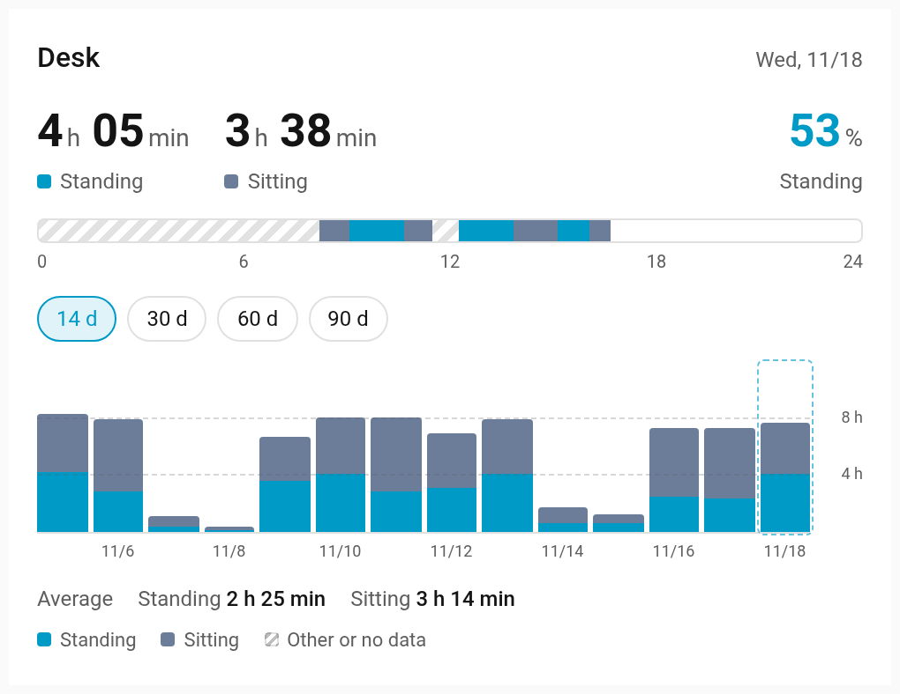
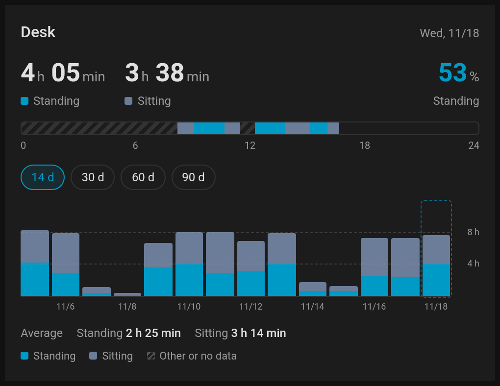
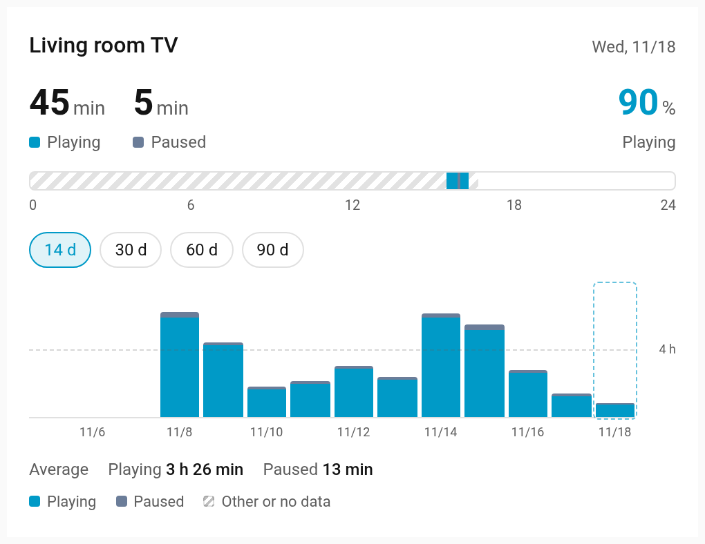
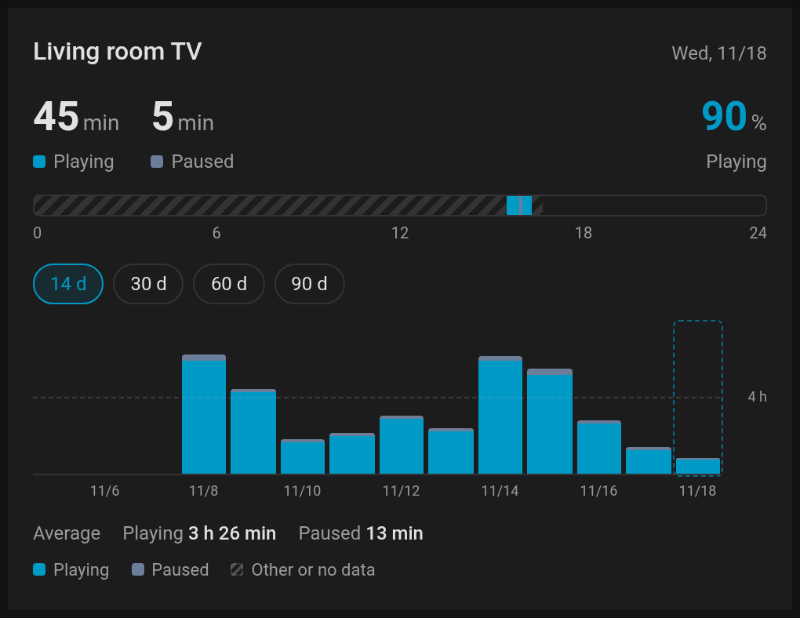

# State time card

Home Assistant dashboard card for how much of each day an entity spent in each of its states, with today's timeline and
a bar per day.

[![GitHub Release][releases-shield]][releases] [![GitHub Release Date][release-date-shield]][releases] [![Downloads][downloads-shield]][releases] [![Marketplace][marketplace-shield]][marketplace] [![License][license-shield]](LICENSE)

<p>




</p>

## What is it?

A custom card that answers how long something was in a state, day by day, such as how long the TV played, how long the
desk was up, how long the heat pump defrosted or the car charged. You choose an entity and the states to count. The card shows
today's time in each state, today's timeline from midnight, and a stacked bar per day over the last 14, 30, 60 or 90
days, with each state's daily average.

It works with any entity that has states, from a switch or a binary sensor to a media player, a climate entity's
`hvac_action` as a template sensor, or a template sensor of your own that combines several things into one state. It
needs nothing but the entity to start with, as the days come from Home Assistant's own history. To keep days for longer
than the history keeps them, give a state a [counter](#counters).

## Installation

### With the Marketplace

1. Open Settings › Marketplace, choose Add from link and paste `https://github.com/jesmak/state-time-card`
2. Open State time card in the Marketplace and choose Install
3. Refresh your browser

### Manual

1. Take `dist/state-time-card.js` from the source code of the [latest release][releases] and copy it to the
   `config/www` folder of your Home Assistant installation
2. In Home Assistant settings, open dashboards, click the three dots at the top right and open resources
3. Add a new resource with the path `/local/state-time-card.js` and type JavaScript
4. Refresh your browser

## Options

Everything can be set in the card's visual editor.

| Name       | Type   | Description                                                                                                    | Default           |
| ---------- | ------ | -------------------------------------------------------------------------------------------------------------- | ----------------- |
| `entity`   | string | The entity whose states are counted                                                                            | required          |
| `states`   | list   | The states to count, each a state as Home Assistant stores it, such as `on` or `playing`, or an object (below) | required          |
| `title`    | string | The card's title                                                                                               | the entity's name |
| `days`     | number | The range the bars open at, 14, 30, 60 or 90 days. The chips on the card switch between them                   | `14`              |
| `row_step` | string | In a sections view with automatic row height, whether the card's height is rounded up to `full` or `half` rows | `full`            |

A state written as an object takes these:

| Name      | Type   | Description                                                                                            | Default                              |
| --------- | ------ | ------------------------------------------------------------------------------------------------------ | ------------------------------------ |
| `state`   | string | The state as Home Assistant stores it                                                                  | required                             |
| `name`    | string | The name shown for it                                                                                  | the state as Home Assistant shows it |
| `color`   | string | Any CSS colour                                                                                         | a colour from the theme              |
| `counter` | string | A History Stats sensor for this state, whose statistics keep its days for good ([counters](#counters)) |                                      |

## What it shows

- **Today's time in each state** as large figures, and with more than one state, the first state's share of the time
  counted.
- **Today's timeline** from midnight to now, each counted state in its colour. A state not counted, and time with no
  data, is hatched. Hovering over a stretch shows its state and times.
- **A bar per day** over the range chosen with the chips, the states stacked, today outlined, with a line every four
  hours. Hovering over a bar shows the day's time in each state. A day before the history starts has no bar.
- **Each state's average** per day, today left out as it isn't over yet, and a legend.

Days are Home Assistant's own, in its time zone, whatever time zone the browser is in.

## Counters

Without a counter, the card reads a state's days from the entity's history, which Home Assistant's recorder keeps for
10 days by default (`purge_keep_days`). Days older than that have no bar. Long-term statistics, which the recorder keeps
for good, are made only for sensors with numbers, so a state's time needs a sensor that counts it. History Stats does:

1. Open Settings › Devices & services › Helpers, choose Create helper and then History Stats
2. Give it a name, choose the entity, and keep the type as time
3. Choose the state it counts
4. Set the start to `{{ today_at() }}` and the end to `{{ now() }}`, and leave the duration empty
5. In the card's editor, choose the new sensor as the state's counter

Make one for each state that should keep its days. The counter counts from the day it is made. Until it has every day
of the range, the card fills the days it doesn't have from the entity's history, as far as that reaches.

A counter must start at midnight, as above, since the card reads each day's total as the counter's highest value
that day.

## Sizes

The card is 12 columns wide by default and fits down to 6. In a sections view with automatic row height it takes the
whole rows it needs, or half rows with `row_step: half`, and spreads the room left over between its parts. Given more
rows in the layout tab, its bars grow into the room. At 90 days the bars get thin in a narrow card, but every day keeps
its own.

## Colours

Each state takes a colour from the theme in turn, first the theme's primary colour, then a muted slate, then its info,
warning, success and error colours. The slate can be changed for every card with the theme variable
`state-time-card-second-color`. A state's own `color` wins over both.

## Examples

### Screen time

```yaml
type: custom:state-time-card
entity: media_player.living_room_tv
states:
  - playing
  - paused
```

### A switch, counted while on, for 90 days

```yaml
type: custom:state-time-card
entity: switch.game_console
title: Console
days: 90
states:
  - state: "on"
    name: Playing
    counter: sensor.console_on_today
```

### Standing at a desk

A template sensor that is `standing` while the computer's screen is on and the desk is up, `sitting` while it is down,
and `away` while the screen is off:

```jinja

away
{{ this.state if this.state in ['standing', 'sitting'] else none }}
standing
sitting

```

And the card, with a counter for each state:

```yaml
type: custom:state-time-card
entity: sensor.desk_position
title: Desk
states:
  - state: standing
    name: Standing
    counter: sensor.desk_standing_today
  - state: sitting
    name: Sitting
    counter: sensor.desk_sitting_today
```

## Data

Everything comes from your own Home Assistant's recorder, the entity's state history and the counters' long-term
statistics. The card sends nothing anywhere.

## Translating

The card's texts are in `src/localize/languages/`, one JSON file per language, named by its language code, such as
`en.json` and `fi.json`. To add a language, copy `en.json` to the new language's code, such as `sv.json`, and translate
the values. Nothing else needs changing. The card finds the file by itself and uses it when Home Assistant is set to
that language. A text left out falls back to English. State names come from Home Assistant, in its language, unless you
name them yourself.

## Development

Requires Node 22.13 or newer.

```
npm install
npm run check
```

`npm run check` typechecks, lints, checks formatting, runs the tests and builds `dist/state-time-card.js`, which is the
file the Marketplace installs and is committed to the repository.

| Path                      | What it contains                                                          |
| ------------------------- | ------------------------------------------------------------------------- |
| `src/state-time-card.ts`  | The card itself                                                           |
| `src/editor.ts`           | The visual editor                                                         |
| `src/data.ts`             | Days, the timeline and the daily totals from the history and the counters |
| `src/types.ts`            | The configuration and the states' colours                                 |
| `src/height.ts`           | The height a card is held to                                              |
| `src/rows.ts`             | Filling whole or half rows in a sections view                             |
| `src/localize/languages/` | The card's texts, one JSON file per language                              |
| `docs/screenshots.json`   | The made-up data the README's screenshots are taken from                  |
| `tests/`                  | Tests, run with vitest                                                    |

## Support

Hey dude! Help me out for a couple of :beers: or a :coffee:!

[](https://www.buymeacoffee.com/jesmak)

## License

MIT, see [LICENSE](LICENSE).

[releases-shield]: https://img.shields.io/github/release/jesmak/state-time-card.svg?style=for-the-badge
[release-date-shield]: https://img.shields.io/github/release-date/jesmak/state-time-card?style=for-the-badge
[releases]: https://github.com/jesmak/state-time-card/releases
[downloads-shield]: https://img.shields.io/github/downloads/jesmak/state-time-card/total.svg?style=for-the-badge
[marketplace-shield]: https://img.shields.io/badge/Marketplace-Custom-orange.svg?style=for-the-badge
[marketplace]: https://my.home-assistant.io/redirect/marketplace_repository/?owner=jesmak&repository=state-time-card&category=plugin
[license-shield]: https://img.shields.io/github/license/jesmak/state-time-card.svg?style=for-the-badge
